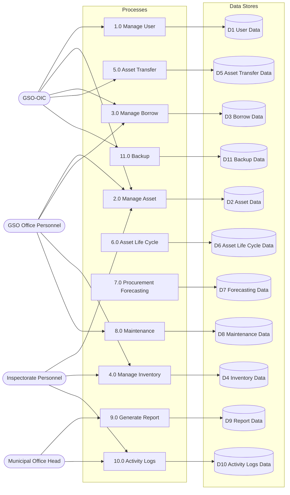
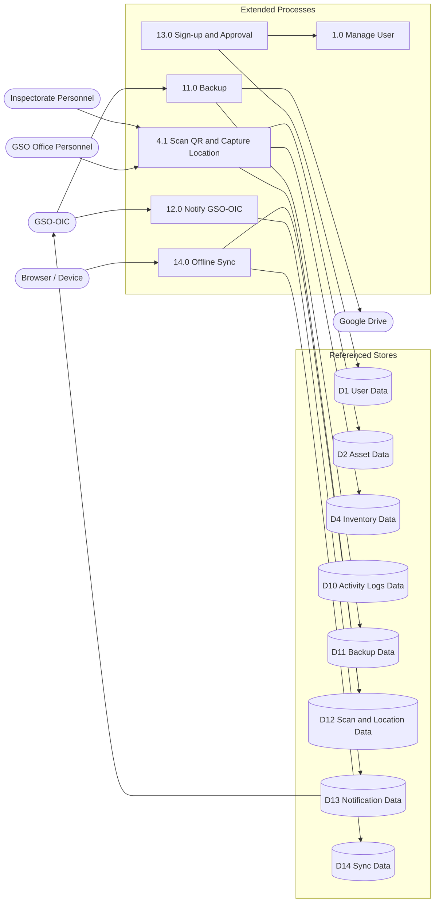

# Katipunan AMS — Updated Data Flow Diagram

This is the implemented DFD: the original core stores **D1–D11** plus the
final-system additions **D12 Scan & Location**, **D13 Notifications**, and
**D14 Sync**. The numbered processes follow the original diagram; Processes
4.1, 12.0, 13.0, and 14.0 are the implemented extensions.

`app_state` is not a DFD data store. It is the backend’s JSON snapshot that
projects into D2–D10; the logical DFD contains only D1–D14.

## Core DFD (original D1–D11)

## Final-system extensions

## Data-store map

| DFD store | Physical table(s) | View |
| --- | --- | --- |
| D1 User Data | `users`, `sessions` | `D1 User Data` |
| D2 Asset Data | `assets` | `D2 Asset Data` |
| D3 Borrow Data | `borrow` | `D3 Borrow Data` |
| D4 Inventory Data | `inventory` | `D4 Inventory Data` |
| D5 Asset Transfer Data | `asset_transfer` | `D5 Asset Transfer Data` |
| D6 Asset Life Cycle Data | `asset_lifecycle` | `D6 Asset Life Cycle Data` |
| D7 Forecasting Data | `procurement_forecast` | `D7 Forecasting Data` |
| D8 Maintenance Data | `maintenance_asset_report` | `D8 Maintenance Data` |
| D9 Report Data | `report` | `D9 Report Data` |
| D10 Activity Logs Data | `activity_log`, `audit` | `D10 Activity Logs Data` |
| D11 Backup Data | `backup` | `D11 Backup Data` |
| D12 Scan and Location Data | `asset_scan` | `D12 Scan and Location Data` |
| D13 Notification Data | `notifications` | `D13 Notification Data` |
| D14 Sync Data | `sync_events` | `D14 Sync Data` |

The detailed process/table mapping and implementation notes are in
[`DFD_MAPPING.md`](DFD_MAPPING.md).

The DFD-named views are inside `katipunan_ams` under **Views**, not separate
databases. On Windows/MariaDB they display lowercase in phpMyAdmin because of
`lower_case_table_names=1`; query them with backticks if needed.
