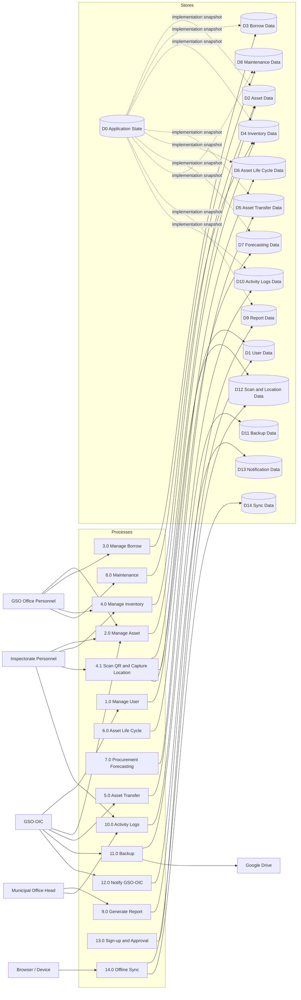

# Implemented System DFD and Database Mapping

This document aligns the working Katipunan AMS with the proposed DFD and the
final database. It uses **Option 1**: the physical tables keep their working
names, while DFD-named read-only views expose the same data under the DFD data
store names.

## Why this matches the final system

- Every physical table is represented by a DFD view (D0–D14).
- Every process in the original DFD (1.0–11.0) is still implemented.
- The final system adds:
  - **4.1 QR Scan & Location Capture**
  - **12.0 GSO-OIC Notifications**
  - **13.0 Sign-up & Approval**
  - **14.0 Offline Scan Synchronization**
  - **D12 Scan & Location Data**
  - **D13 Notification Data**
  - **D14 Sync Data**
- No table was renamed, so the running application is unaffected.

`app_state` is the application’s authoritative JSON snapshot. It is shown as
**D0 Application State** for completeness; it supports the logical stores
D2–D10. The normalized tables are rebuilt from `app_state` on save.

## External entities

| Entity | Role in the system |
| --- | --- |
| GSO-OIC | Administrator, user approval, asset supervision, notifications, backups |
| Inspectorate Personnel | Asset inspection, QR scanning, condition verification |
| GSO Office Personnel | Asset registration, inventory, borrow, maintenance |
| Municipal Office Head | Office-scoped assets and reports |
| Google Drive | Optional external backup destination |
| Browser / Device | Camera, geolocation, PWA offline queue |

## Processes

| DFD process | Implemented as |
| --- | --- |
| 1.0 Manage User | Login, sessions, self sign-up, GSO-OIC approval, User administration (`/api/auth/*`, `/api/users`, `admin.html`) |
| 2.0 Manage Asset | Asset add/edit/delete/restore, QR generation (`/api/assets`, asset screens) |
| 3.0 Manage Borrow | Borrow slip, approval/rejection, return (`borrow`) |
| 4.0 Inspect/Manage Inventory | Inventory records and asset monitoring (`inventory`) |
| **4.1 Scan QR & Capture Location** | Camera/mobile scanner, geolocation, map, scan history (`/api/scans`, `asset_scan`) |
| 5.0 Asset Transfer | Transfer records (`asset_transfer`) |
| 6.0 Asset Life Cycle | Lifecycle stage and remaining life (`asset_lifecycle`) |
| 7.0 Procurement Forecasting | Forecast and priority (`procurement_forecast`) |
| 8.0 Maintenance Report | Repair/maintenance records (`maintenance_asset_report`) |
| 9.0 Generate Report | Report generation and history (`report`, `/api/reports`) |
| 10.0 Activity Logs | Application activity and security audit (`activity_log`, `audit`) |
| 11.0 Backup | Server JSON, hard drive, Google Drive, restore (`backup`, `/api/backup`, `/api/export`, `/api/import`) |
| **12.0 Notify GSO-OIC** | Backend diff engine, read/unread, SSE live feed (`notifications.py`) |
| **13.0 Sign-up & Approval** | Public registration for Inspectorate/GSO Office/Municipal Office Head, OIC approval (`/api/auth/register`) |
| **14.0 Offline Sync** | IndexedDB scan queue, automatic retry, duplicate prevention (`scan-sync.js`, `/api/scans`, `sync_events`) |

## Data stores and physical tables

| DFD store | Physical table(s) | DFD view |
| --- | --- | --- |
| D0 Application State | `app_state` | `D0_Application_State` |
| D1 User Data | `users`, `sessions` | `D1_User_Data` |
| D2 Asset Data | `assets` | `D2_Asset_Data` |
| D3 Borrow Data | `borrow` | `D3_Borrow_Data` |
| D4 Inventory Data | `inventory` | `D4_Inventory_Data` |
| D5 Asset Transfer Data | `asset_transfer` | `D5_Asset_Transfer_Data` |
| D6 Asset Life Cycle Data | `asset_lifecycle` | `D6_Asset_Life_Cycle_Data` |
| D7 Forecasting Data | `procurement_forecast` | `D7_Forecasting_Data` |
| D8 Maintenance Data | `maintenance_asset_report` | `D8_Maintenance_Data` |
| D9 Report Data | `report` | `D9_Report_Data` |
| D10 Activity Logs Data | `activity_log`, `audit` | `D10_Activity_Logs_Data` |
| D11 Backup Data | `backup` | `D11_Backup_Data` |
| D12 Scan & Location Data | `asset_scan` | `D12_Scan_Location_Data` |
| D13 Notification Data | `notifications` | `D13_Notification_Data` |
| D14 Sync Data | `sync_events` | `D14_Sync_Data` |

All 17 physical tables are covered. Views are read-only and do not change the
application’s behavior.

## DFD

## Notes

- D12 is the authoritative scan/location history. It never changes the asset’s
  official `location`, `latitude`, or `longitude`; the D12 view also calculates
  `distance_m` from registered coordinates when both exist.
- D10 combines the application activity log and the security audit trail; the
  `source` column distinguishes `activity` from `audit`.
- D1 excludes session tokens and D9 excludes file contents; the views expose
  only reporting fields.
- `D0_Application_State` shows key names, update metadata, and value size — not
  the full JSON payload — so it remains safe for reporting.
- The views are created by `docs/dfd_views.sql` and also included in
  `docs/katipunan_ams_install.sql`. They are optional for the application and
  can be dropped without affecting it.
