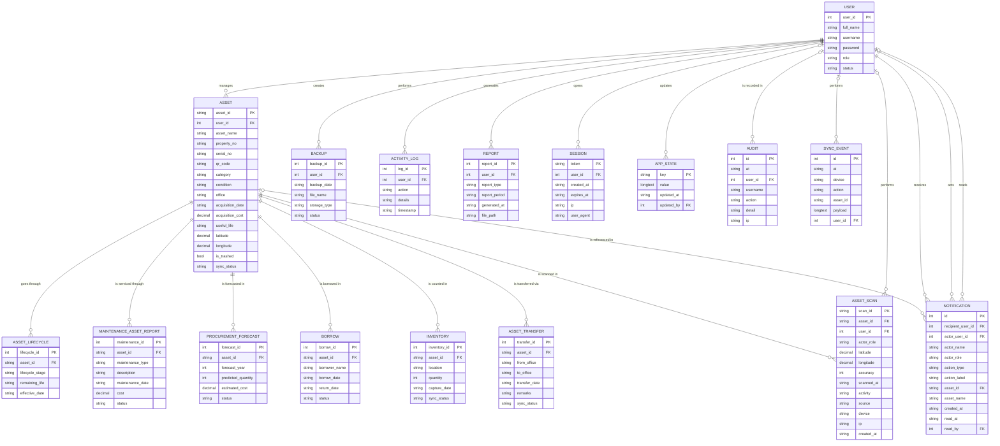

# ERD — Katipunan Asset Management System

> Consolidated DFD, ERD, and class diagrams: [`SYSTEM_DIAGRAMS.md`](SYSTEM_DIAGRAMS.md).

This document records the ERD implemented in MariaDB (XAMPP), the physical
table names, and how each entity maps to the v71 application.

## Diagram



The generated DDL for this schema is in
[`katipunan_ams_schema.sql`](katipunan_ams_schema.sql).

```sql
-- Example: inspect the normalized asset register
SELECT a.asset_id, a.asset_name, a.`condition`, a.office, a.acquisition_cost,
       l.lifecycle_stage, l.remaining_life,
       f.predicted_quantity, f.status AS forecast_status
FROM assets a
LEFT JOIN asset_lifecycle l ON l.asset_id = a.asset_id
LEFT JOIN procurement_forecast f
       ON f.asset_id = a.asset_id AND f.forecast_year = YEAR(CURDATE())
WHERE a.is_trashed = 0
ORDER BY a.asset_id
LIMIT 20;
```

## Physical tables

| ERD entity | MariaDB table | Notes |
| --- | --- | --- |
| `USER` | `users` | Existing account table. `user_id` = `id`, `full_name` = `name`, `password` = `password_hash` (PBKDF2-SHA256), `status` = `active`. |
| `ASSET` | `assets` | One row per equipment record; `asset_id` is the app's equipment ID (e.g. `HR-EQ1`). |
| `ASSET_LIFECYCLE` | `asset_lifecycle` | Current stage and remaining useful life per asset. |
| `MAINTENANCE_ASSET_REPORT` | `maintenance_asset_report` | Repair / maintenance history. |
| `PROCUREMENT_FORECAST` | `procurement_forecast` | One forecast row per asset per year. |
| `BACKUP` | `backup` | Server JSON exports and recorded client backups. |
| `ACTIVITY_LOG` | `activity_log` | The app's activity log (`mets_log`). |
| `REPORT` | `report` | Generated report records (CSV, print, summary). |
| `BORROW` | `borrow` | Borrow / issuance records. |
| `INVENTORY` | `inventory` | Current location and capture date per asset. |
| `ASSET_TRANSFER` | `asset_transfer` | Transfer history between offices. |

## Operational tables

| Table | Purpose |
| --- | --- |
| `sessions` | Bearer login sessions |
| `audit` | Server-side security/audit trail |
| `sync_events` | Device sync records |
| `notifications` | GSO-OIC activity feed generated automatically by the backend |
| `asset_scan` | One row per QR scan: client idempotency key (`scan_id`), asset, user, role snapshot, latitude/longitude/accuracy, scan time, activity, source, device, and IP. This is the authoritative scan/location history. It never modifies the asset's registered location or registered coordinates. |
| `app_state` | Backend JSON snapshot for state hydration and offline synchronization. It is not a DFD data store. |

### Why `asset_scan` exists

`sync_events` records device sync actions as opaque JSON, and `inventory` stores a
single current row per asset. Neither supports a queryable per-asset scan
history with coordinates and the user who performed the scan. `asset_scan`
adds that history with foreign keys to `assets` and `users`; the client
generates the `scan_id`, so retries and offline synchronization are idempotent.

The implemented DFD, including data stores D1–D14 and DFD-named SQL views, is in
[`DFD_MAPPING.md`](DFD_MAPPING.md).

## Relationship implementation

- `assets.user_id` → `users.id`, `ON DELETE SET NULL` (history survives when an account is removed).
- All asset child tables reference `assets.asset_id` with `ON DELETE CASCADE`.
- `backup.user_id`, `activity_log.user_id`, and `report.user_id` reference `users.id` with `ON DELETE SET NULL`.
- `sessions.user_id` references `users.id` with `ON DELETE CASCADE`.
- `asset_scan.user_id` references `users.id` with `ON DELETE SET NULL`.
- `app_state.updated_by`, `audit.user_id`, and `sync_events.user_id` reference `users.id` with `ON DELETE SET NULL`.
- `notifications.recipient_user_id` references `users.id` with `ON DELETE CASCADE`; `actor_user_id` and `read_by` use `ON DELETE SET NULL`; `asset_id` references `assets.asset_id` with `ON DELETE SET NULL`.

## Additional columns (application compatibility)

The ERD columns are all present. A few extra columns preserve values used by
the v71 interface:

| Table | Extra columns | Purpose |
| --- | --- | --- |
| `assets` | `brand`, `staff_id`, `owner_name`, `owner_position`, `location`, `last_scan_date`, `last_scan_location`, `created_at`, `updated_at` | Equipment details, accountable personnel, scan information. |
| `maintenance_asset_report` | `technician`, `recorded_at` | Service provider and capture time. |
| `procurement_forecast` | `priority`, `bucket` | Forecasting score band (`critical/high/...`) and replacement window. |
| `borrow` | `recorded_at` | Time the record was captured. |
| `report` | `generated_at`, `file_path` | Already in the ERD; used for de-duplication and downloads. |

## How the tables stay in sync

The v71 client is localStorage-first and synchronizes a JSON snapshot through
`PUT /api/state`. The backend keeps that snapshot in `app_state` (for offline
sync and features not covered by the ERD, such as photos, settings, and the
recycle bin) and projects the domain records into the normalized tables in the
same transaction:

```text
browser localStorage
        │  PUT /api/state
        ▼
   app_state (JSON snapshot)
        │  sync_erd()
        ▼
assets ─ asset_lifecycle ─ inventory ─ procurement_forecast
   ├── maintenance_asset_report
   ├── borrow
   └── asset_transfer

users ─ activity_log ─ report ─ backup
```

Projection points:

- server startup (`init_db()`),
- every state save that changes `mets_staffdata`, `mets_repairs`,
  `mets_borrows`, `mets_transfers`, or `mets_log`,
- asset PATCH,
- JSON import,
- state reset (which clears the normalized tables too).

`POST /api/reports` and `POST /api/backups` add records when the app generates
a report or completes a backup. JSON exports through `GET /api/export` add a
`server-json` backup row automatically.

## Accounting / forecasting logic

The normalized tables mirror the browser modules:

- **Life cycle** — stage is derived from condition and remaining useful life
  (`In Service`, `Under Repair`, `End of Life`, `Lost`, `Missing`).
- **Forecast** — condition, elapsed life, repair count, and repair cost produce
  a priority and replacement bucket, matching the Procurement Forecasting
  module's scoring. `predicted_quantity` is 1 for `Replace now` and
  `Within 1 year`.
- **Inventory** — one current row per asset with its location and scan date.
