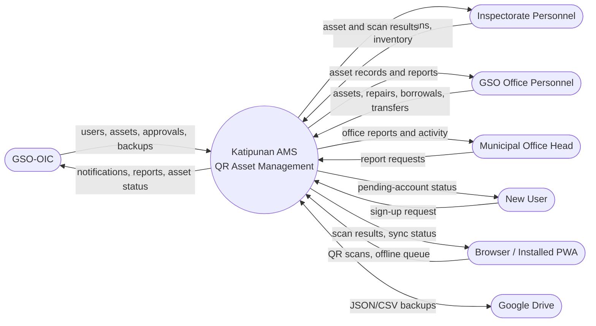
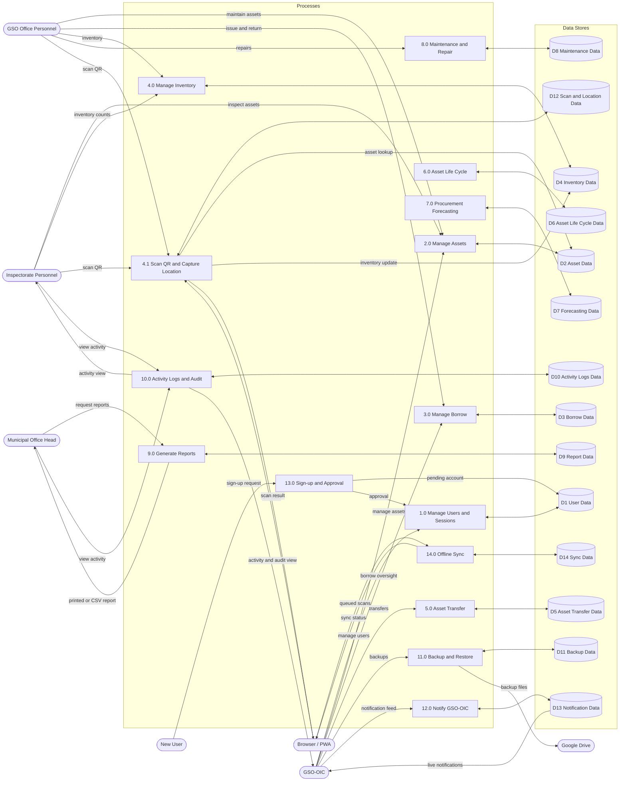
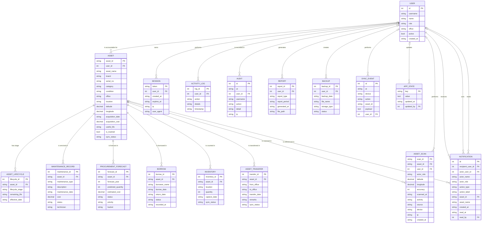
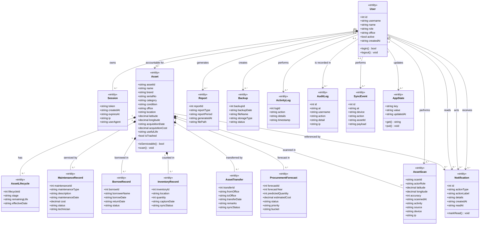
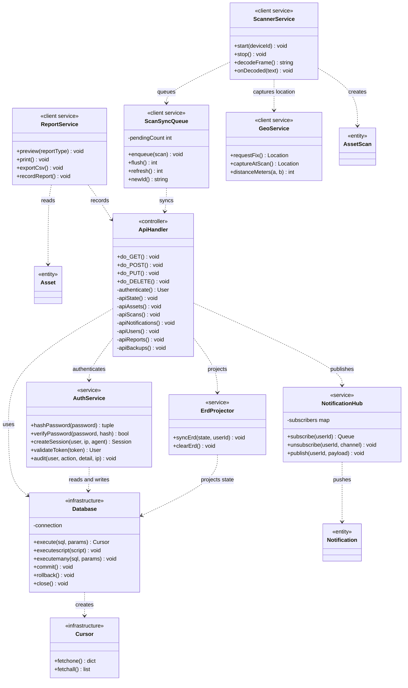

# Katipunan AMS — System Diagrams

This document contains the three design views of the implemented system:

1. **Data Flow Diagram (DFD)** — context and Level 1
2. **Entity Relationship Diagram (ERD)** — 17 tables and 20 foreign keys
3. **Class Diagram** — domain entities and application/service classes

The diagrams use Mermaid, which renders directly on GitHub and in VS Code
Markdown preview. The detailed process mapping, table notes, and scanner design
remain in [`DFD_MAPPING.md`](DFD_MAPPING.md), [`ERD.md`](ERD.md), and
[`SCANNER_GEOLOCATION.md`](SCANNER_GEOLOCATION.md).

> `app_state` is the backend JSON snapshot used for hydration and offline sync.
> It is an implementation table, not a DFD data store. The DFD stores remain
> **D1–D14**, and each is exposed as a read-only view in `katipunan_ams`.

---

## 1. Data Flow Diagram

### 1.1 Context Diagram (Level 0)

### 1.2 Level 1 Data Flow Diagram

### 1.3 DFD data-store map

| DFD store | Physical table(s) | Read-only view |
| --- | --- | --- |
| D1 User Data | `users`, `sessions` | `D1 User Data` |
| D2 Asset Data | `assets` | `D2 Asset Data` |
| D3 Borrow Data | `borrow` | `D3 Borrow Data` |
| D4 Inventory Data | `inventory` | `D4 Inventory Data` |
| D5 Asset Transfer Data | `asset_transfer` | `D5 Asset Transfer Data` |
| D6 Asset Life Cycle Data | `asset_lifecycle` | `D6 Asset Life Cycle Data` |
| D7 Forecasting Data | `procurement_forecast` | `D7 Forecasting Data` |
| D8 Maintenance Data | `maintenance_asset_report` | `D8 Maintenance Data` |
| D9 Report Data | `report` | `D9 Report Data` |
| D10 Activity Logs Data | `activity_log`, `audit` | `D10 Activity Logs Data` |
| D11 Backup Data | `backup` | `D11 Backup Data` |
| D12 Scan and Location Data | `asset_scan` | `D12 Scan and Location Data` |
| D13 Notification Data | `notifications` | `D13 Notification Data` |
| D14 Sync Data | `sync_events` | `D14 Sync Data` |

---

## 2. Entity Relationship Diagram

The implemented schema has **17 base tables** and **20 foreign keys**. Child
records are removed with their asset (`ON DELETE CASCADE`); historical records
such as audit, activity, sync, and backups preserve their rows when a user is
removed (`ON DELETE SET NULL`).

### 2.1 Physical table map

| Logical entity | Physical table | Notes |
| --- | --- | --- |
| `USER` | `users` | Accounts and roles |
| `SESSION` | `sessions` | Bearer sessions |
| `ASSET` | `assets` | Asset register |
| `ASSET_LIFECYCLE` | `asset_lifecycle` | Current life-cycle stage |
| `MAINTENANCE_RECORD` | `maintenance_asset_report` | Repair and maintenance history |
| `PROCUREMENT_FORECAST` | `procurement_forecast` | Replacement/forecast rows |
| `BORROW` | `borrow` | Borrow and issuance history |
| `INVENTORY` | `inventory` | Inventory snapshot |
| `ASSET_TRANSFER` | `asset_transfer` | Office-to-office transfers |
| `ASSET_SCAN` | `asset_scan` | QR scan and location history |
| `APP_STATE` | `app_state` | JSON state snapshot, not a DFD store |
| `ACTIVITY_LOG` | `activity_log` | Application activity log |
| `AUDIT` | `audit` | Security audit trail |
| `REPORT` | `report` | Generated-report records |
| `BACKUP` | `backup` | Backup records |
| `SYNC_EVENT` | `sync_events` | Device synchronization records |
| `NOTIFICATION` | `notifications` | GSO-OIC notification feed |

---

## 3. Class Diagram

### 3.1 Domain model

### 3.2 Application and service classes

The backend is function-oriented, so `ApiHandler`, `AuthService`,
`ErdProjector`, `ReportService`, `ScannerService`, and `GeoService` are logical
UML service classes mapped to code modules. `Database`, `Cursor`, and
`NotificationHub` are actual Python classes. `ScanSyncQueue` is the client-side
`KatScanQueue` object.

---

## 4. Related documentation

- [`DFD_MAPPING.md`](DFD_MAPPING.md) — process, data-store, and table mapping
- [`DFD_DIAGRAM.md`](DFD_DIAGRAM.md) — earlier core and extension DFD views
- [`ERD.md`](ERD.md) — detailed ERD notes and relationship implementation
- [`SCANNER_GEOLOCATION.md`](SCANNER_GEOLOCATION.md) — scan, GPS, map, and offline queue design
- [`katipunan_ams_install.sql`](katipunan_ams_install.sql) — installable schema
- [`katipunan_ams_schema.sql`](katipunan_ams_schema.sql) — generated schema dump
